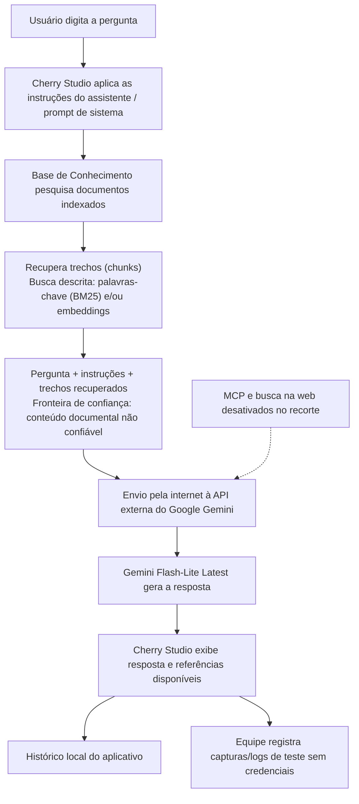

# Fluxo de Dados: Base de Conhecimento e RAG

> **Propósito:** Descrever o percurso da pergunta e dos trechos recuperados no recorte avaliado do Cherry Studio, destacando fronteiras de confiança e exposição de dados.

---

## 1. Escopo observado

O fluxo documentado é o do chat em modo Agent do Cherry Studio 2.0.13, consultando a Base de Conhecimento e enviando a solicitação ao Gemini Flash-Lite Latest. MCP e busca na web ficam desativados. O diagrama representa o comportamento descrito pela equipe; detalhes internos de busca, composição do prompt, chunking e tratamento das referências não foram auditados no código do aplicativo.

## 2. Diagrama de fluxo de dados

## 3. Etapas e dados envolvidos

1. **Pergunta:** o usuário envia uma consulta pelo chat.
2. **Instruções:** o aplicativo combina a entrada com as instruções do assistente/prompt de sistema.
3. **Recuperação:** a Base de Conhecimento pesquisa o corpus cadastrado, previamente dividido em *chunks* e indexado. A equipe descreve a recuperação como busca por palavras-chave (BM25) e/ou embeddings; a configuração efetivamente usada deve ser confirmada no aplicativo.
4. **Composição do contexto:** a pergunta e os trechos recuperados são incluídos na solicitação. Esse é o principal limite de confiança do recorte: texto de documentos externos pode ser interpretado como instrução pelo modelo se não for tratado como dado não confiável.
5. **Envio ao provedor:** o contexto é transmitido pela internet à API do Google Gemini. Portanto, somente dados públicos ou sintéticos devem ser usados na Base de Conhecimento.
6. **Ferramentas:** MCP e busca na web estão desativados; não fazem parte do percurso de execução avaliado.
7. **Resposta e referências:** a resposta retorna ao Cherry Studio e é apresentada ao usuário com as referências que o aplicativo disponibilizar. A equipe verificará empiricamente se as citações correspondem aos documentos e trechos usados.
8. **Persistência e evidências:** a conversa fica no histórico local do aplicativo. A equipe registra capturas e logs dos testes, removendo chaves, tokens e outros segredos antes de compartilhar evidências.

## 4. Fronteiras de confiança e pontos de atenção

- **Documentos → contexto do modelo:** documentos sintéticos, públicos, irrelevantes, conflitantes ou maliciosos são conteúdo não confiável. Uma instrução embutida em documento pode tentar influenciar a resposta (injeção indireta).
- **Aplicativo → provedor externo:** pergunta, instruções e trechos recuperados deixam o computador e são enviados ao provedor. Não inserir dados reais de pacientes, empresas, usuários ou credenciais.
- **Resposta → usuário:** uma resposta pode conter afirmações sem suporte ou referências imprecisas; conferir cada afirmação contra o trecho citado.
- **Histórico/evidências:** conversas e capturas podem conter dados da consulta. Usar apenas conteúdo de teste e revisar evidências antes de publicá-las.

## 5. Resultados do mapeamento

O principal risco do fluxo está na composição do contexto: o conteúdo recuperado é enviado junto das instruções e da pergunta, sem que a equipe tenha confirmado uma separação técnica entre dados e instruções. Isso justifica os testes de contexto sob pressão, injeção indireta e auditoria de citações. O diagrama documenta o fluxo esperado/observado, mas não substitui evidências de execução; registrar capturas do aplicativo e a configuração efetiva de recuperação para sustentar os resultados.
