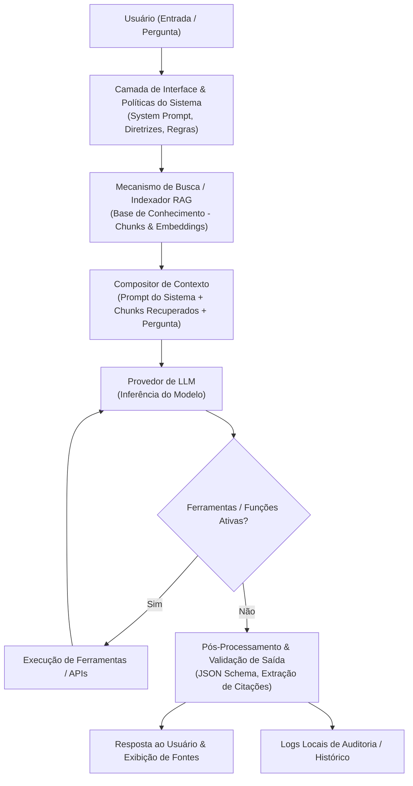

# Fluxo de Dados: Base de Conhecimento e RAG

> **Propósito:** Mapear o ciclo de vida completo da informação no Cherry Studio, desde a entrada do usuário e injeção de contexto até a geração de resposta, fontes e logs.

---

## 1. Tarefa
Modelar e documentar o fluxo de dados arquitetural do Cherry Studio durante o processamento de consultas RAG na Base de Conhecimento, identificando pontos de controle, injeção de políticas e potenciais vetores de vulnerabilidade.

---

## 2. Análise do Artefato

### 2.1 Diagrama de Fluxo de Dados

### 2.2 Descrição das Etapas do Fluxo
1. **Entrada do Usuário:** Pergunta ou comando submetido na interface do chat.
2. **Políticas e Pré-prompt:** Aplicação de diretrizes de sistema (*System Prompt*) e limites configurados pelo usuário.
3. **Mecanismo RAG / Busca de Contexto:** Consulta vetorial/semântica aos documentos sintéticos previamente fatiados (*chunks*) e indexados.
4. **Composição do Prompt Aumentado:** Montagem do prompt final que agrupa instruções do sistema, contexto documental recuperado e a consulta do usuário.
5. **Inferência no Modelo (LLM):** Envio da carga útil à API/modelo local para geração de texto ou JSON.
6. **Ferramentas (se aplicável):** Acionamento de integrações externas para complementação de resposta.
7. **Pós-processamento e Citações:** Renderização da resposta, mapeamento de referências bibliográficas/fontes e gravação em logs de histórico.

---

## 3. Resultados
- **Pontos Críticos de Exposição Identificados:**
  - Injeção Indireta de Prompt: [PREENCHER - ex.: Falha na separação lógica entre instrução e dados nos chunks]
  - Alucinação de Fontes: [PREENCHER - ex.: Resposta cita documento inexistente ou atribui trecho incorreto]
- **Observações de Arquitetura:** [PREENCHER]
